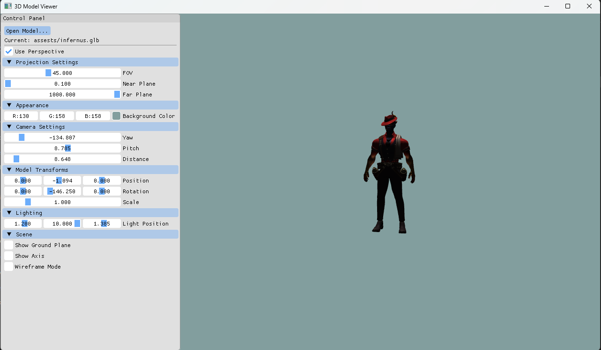

# 3DEngine


A small real-time 3D model viewer built with OpenGL. It loads a 3D model
(`.glb`, `.gltf`, `.obj`, and more via Assimp) and renders it with a Dear ImGui
control panel for adjusting the camera, projection, lighting, and model
transform in real time.



## Features

- Runs in a normal resizable window (minimize, maximize, close)
- "Open Model..." button loads any model at runtime through a file picker
- Supports many formats via Assimp: glb, gltf, obj, fbx, dae, stl, ply, 3ds, and more
- Loads embedded textures
- Orbit camera with mouse look and scroll zoom (yaw, pitch, and distance controls)
- Perspective and orthographic projection
- Adjustable FOV, near/far planes, light position, and background color
- Move, rotate, and scale the model from the UI or the keyboard
- Ground plane and coordinate axis toggles
- Wireframe toggle
- Dear ImGui control panel on the left

## Download and run (Windows)

1. Download `3DEngine-windows.zip`.
2. Extract it anywhere.
3. Double-click `ComputerGraphics.exe`.

Keep `ComputerGraphics.exe`, the `shaders/` and `assests/` folders, and the
bundled `.dll` files together in the same folder. The runtime DLLs are included,
so no extra installers are required.

## Controls

Mouse:

- Right-drag: orbit the camera
- Left-drag: rotate the model
- Scroll: zoom in and out

Keyboard:

- `W` `A` `S` `D`: move the model along X and Z
- `Q` `E`: move the model up and down
- `Z` `X`: scale down and up
- `F`: toggle wireframe
- `R`: reset the view

Close the app with the window's close button. Use "Open Model..." in the
control panel to load a different model file.

## Build from source (Windows)

Requirements:

- MSVC (Visual Studio 2022 Build Tools, "Desktop development with C++")
- CMake 3.31 or newer
- Ninja

From a "Developer Command Prompt for VS 2022" (so CMake finds the compiler):

```
cmake -S . -B build -G Ninja -DCMAKE_BUILD_TYPE=Release
cmake --build build
```

The prebuilt GLFW and Assimp libraries under `Libraries/` are MSVC (`vc142`)
builds, so the project must be compiled with MSVC.

## Project layout

- `src/` engine and application source
- `shaders/` GLSL vertex and fragment shaders
- `assests/` sample models (folder name matches the paths used in code)
- `Libraries/` bundled third-party headers and libraries

## Dependencies

GLFW, GLAD, GLM, Assimp, Dear ImGui, and stb_image.
